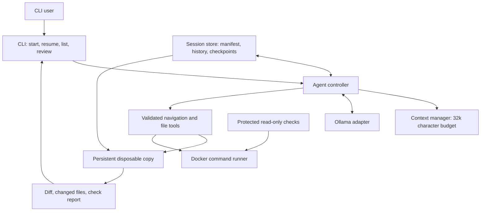

# Capable Coding Harness — Stage 2

A Python CLI that explores a Git repository, gives a local language model bounded context, and edits a disposable copy in a contained Docker environment. Tasks, model history, checkpoints, limits, checks, and diffs are saved so work can be reviewed or resumed safely.

## Requirements and setup

Install Python 3.14, Git, Ollama, and Docker Desktop with Linux containers enabled. The harness uses only the Python standard library; the core test suite needs no model account or API key.

```powershell
py -3.14 -m venv .venv
ollama pull qwen2.5-coder:3b
Get-Content Dockerfile.sandbox -Raw | docker build -t coding-harness-sandbox:local -
```

Start Ollama with `ollama serve`. The default model is `qwen2.5-coder:3b`; choose another installed model with `$env:OLLAMA_MODEL = "model-name"`.

## Start, resume, and review work

Start a task with acceptance or regression commands:

```powershell
.\.venv\Scripts\python.exe -m coding_harness `
  --root "C:\path\to\clean-git-repository" `
  --task "Add the requested behavior and keep existing calls working" `
  --allow-change "src/**" `
  --check "python -m unittest discover -s tests"
```

Repeat `--allow-change` for every permitted path pattern and `--check` for each required check. Without an allowed-path option, all visible files in the disposable repository copy are in scope. A restricted path scope disables the general Bash tool; file tools still enforce the scope. Each allowed Bash request requires an exact `y` approval.

Use `Ctrl+C` to cancel. Completed model/tool steps and turn limits are checkpointed. Resume only after the saved source and working-copy state pass revalidation:

```powershell
.\.venv\Scripts\python.exe -m coding_harness --resume SESSION_ID
.\.venv\Scripts\python.exe -m coding_harness --list-sessions
.\.venv\Scripts\python.exe -m coding_harness --review SESSION_ID
```

Sessions default to `~/.coding-harness/sessions`; pass `--session-dir` to choose another location. A session stores its task, starting commit, path scope, check commands, messages, steps, errors, check results, consumed model-call limit, and persistent disposable workspace. If the original tracked source changes, the saved workspace hash changes, or an action may have been interrupted mid-write, resume pauses for review. It never replays an uncertain action automatically. The model-call limit is cumulative across resumes.

The core session API is `SessionController.create_session/prepare_resume/execute` and `SessionStore.create/load/save/append_event/list_sessions/session_path/workspace_path`. The controller owns policy, checks, and task execution; the CLI handles arguments and presentation.

For checks that must stay outside the model-writable copy, pass a host directory with `--protected-check`. It is mounted read-only in the container at `/protected/0` (then `/protected/1`, and so on). Refer to those paths in the saved check command. Check results are reported as passed, failed, or unavailable; a model's final response cannot turn a failed or missing check into a pass.

## Navigation and context

The model can list and search files, inspect a bounded repository map, find Python classes/functions by name, inspect common dependency declarations, and see the target Git branch, commit, and tracked state. Navigation reads source files; dependency discovery does not execute project configuration.

Model history has a default budget of 32,000 characters, configurable from 2,000 to 64,000. The system rules and initial task remain intact; older conversation is summarized as untrusted data before recent turns are shortened. Tool outputs are capped at 12,000 characters. The model-call limit defaults to 15 and cannot exceed 100 total calls per session. If a final check fails, its untrusted output goes back to the model for another edit within the remaining call budget, then the checks run again. Failed or unavailable checks remain visible in every report.

## Safety and design

- Only tracked, visible regular files are copied from a clean tracked working tree. Hidden paths, Git metadata, links, common credential files, and untracked host files are excluded.
- File tools validate arguments and paths in the application. Optional path scopes apply to file edits. Repository text and model replies remain untrusted.
- Commands and checks run inside a non-root, networkless Docker container with a read-only container root, bounded output, a deadline, and container cleanup. Push, merge, and deployment clients are absent.
- A disposable copy is retained per saved session; the original repository is never edited. Review the exported unified diff and check report before applying changes.
- Session manifests are atomically replaced and events are appended to a JSONL journal. On resume, the exact starting commit, tracked source state, stored permissions, consumed limits, and saved workspace hash are checked again.



## Tests and demo

Run the offline regression suite:

```powershell
.\.venv\Scripts\python.exe -m unittest discover -s tests
```

The suite covers the Stage 1 tools, controller, limits, approvals, and containment, plus navigation, context bounds, persistence, cancellation, and safe resume. `tests/check_containment.ps1` exercises Docker isolation and stopped-child cleanup and requires the sandbox image above.

The real-model demonstration uses the Stage 1 harness as a disposable target and asks the Stage 2 harness to add persistent sessions across its CLI and storage modules. Its protected acceptance check lives outside the target's writable copy. From this repository, run:

```powershell
.\.venv\Scripts\python.exe -m coding_harness `
  --root "C:\Users\Fran\OneDrive\Documentos\Facultad\VIENNA\Clases\AI\SemesterProject" `
  --task "Add persistent coding sessions across the CLI and storage modules. Save task details, starting commit, permissions, checks, history, errors, consumed limits, and workspace checkpoints. Reopen sessions after restart, revalidate source and workspace state, and pause on uncertain interrupted actions. Preserve existing CLI and Stage 1 behavior. Find the relevant modules and use check failures to guide fixes." `
  --allow-change "coding_harness/**" `
  --allow-change "tests/**" `
  --protected-check "C:\Users\Fran\OneDrive\Documentos\Facultad\VIENNA\Clases\AI\Stage2\tests\acceptance" `
  --check "python /protected/0/session_feature_acceptance.py" `
  --check "python -m unittest discover -s tests"
```

Run that task with Ollama, then show the starting commit, changed modules, acceptance and regression results, and final diff. The recorded demo should be no longer than four minutes; the local, ignored `demo-video-script.md` contains the timing and narration outline.

## Credits and limits

The starting CLI, model adapter, runtime, Docker sandbox, result exporter, and Stage 1 tests are carried forward from the author's Stage 1 project. Stage 2 additions and documentation were developed with OpenAI Codex assistance. Ollama and Docker Desktop must be installed separately. Recovery from a changed or uncertain workspace deliberately requires human review.
