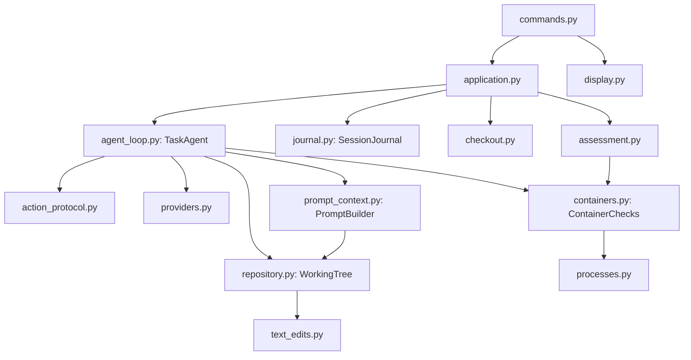

# Coding harness (Stage 2)

This Python application runs a bounded coding agent against an allowlisted project.
It works in a disposable checkout, exposes a small set of validated tools, and judges
results with independent checks. Sessions retain their requests, action history,
checkpoints, diffs, and verification reports so work can be inspected or resumed.
The implementation uses the standard library plus `python-dotenv`, without an agent framework.

## Setup

Use Python 3.11 or newer, Git, Docker, and either a LiteLLM-compatible proxy or
[Ollama](https://ollama.com).

```bash
python -m venv .venv
# Windows activation: .venv\Scripts\Activate.ps1
# macOS/Linux activation: source .venv/bin/activate
python -m pip install -e ".[dev]"
git clone https://github.com/cosmicpython/code targets/cosmicpython
git -C targets/cosmicpython checkout 14c84797ffa77255d53cf1a02fe6aafda2b68aeb
docker build -t coding-harness-cosmic:1 -f docker/Dockerfile targets/cosmicpython
cp .env.example .env
# Windows copy: Copy-Item .env.example .env
```

Fill in `LITELLM_BASE_URL` and `LITELLM_API_KEY` in `.env`. An optional `LITELLM_MODEL`
overrides the configured model name; `--model` takes precedence over both. Run
`python -m harness models` to list the models available to the key. Requests use the
proxy's OpenAI-compatible HTTP endpoint; no LiteLLM SDK is required.

The project used the FH pilot endpoint `https://lion.aida.cs.technikum-wien.at/v1`
with `Qwen/Qwen3.6-35B-A3B`. It shares one GPU and offers best-effort access. At the
time of testing, the hostname did not resolve publicly; access required the FH
network or VPN.

Copy `settings.example.toml` to `settings.toml` to override the defaults. Paths are
relative to the selected settings file. To use a local model, set `[model].provider`
to `ollama` and choose its `name` and endpoint. Keep secrets in the environment.

## Commands

```bash
python -m harness projects
python -m harness start --project cosmicpython --task cancel-allocation
python -m harness list
python -m harness show <session>
python -m harness diff <session>
python -m harness cancel <session>
python -m harness resume <session>
python -m harness resume <session> --accept-state
```

Cancellation can be requested from another terminal or with Ctrl-C. Use
`start --baseline` to check the original commit without contacting a model, or
`start --request "..."` to supply replacement task text. `--settings` selects an
explicit configuration file.

For `start` and `resume`, exit code **0** means the harness verification passed,
**1** means it did not, **2** indicates a usage error, and **3** indicates a paused resume.

## Implementation

The package entry point remains `python -m harness`. Internal Python modules and
symbols have been reorganized; old internal import paths are not compatibility APIs.
CLI text and options, model prompts, tool request keys, settings, SQLite tables,
checkpoint data, and trace formats retain their existing contracts.



`commands.py` handles arguments and command routing; `display.py` renders progress
and reports. `application.py` coordinates session creation, inspection, cancellation,
and resume. The agent loop uses explicit adapters between stable tool names and
renamed repository methods. Protocol strings live separately from execution logic.

Each model call consumes one action before it is made. Replies are parsed, validated,
and dispatched individually. Invalid JSON and failed tools return observations;
identical failed requests are suppressed until a successful edit clears that history.
A configured self-review sends the first final answer back with the same generic
review instruction. Final verification determines the verdict independently of the
model's own claims.

Execution stops on a final answer, model failure, cancellation, the action limit,
the failed-check limit, or five consecutive invalid replies. Cancelled runs do not
start final-check containers and report that verification was not run.

## Context and recovery

Before each model call, `PromptBuilder` rebuilds context within `context_chars`
(60,000 by default, approximately 15,000 tokens). The system instructions and task
remain whole; exceeding the budget with those alone stops the run. Remaining space
is allocated to recent steps (up to 50%), a Python AST repository map (10%), up to
four selected files (25%), and compressed older steps (10%). Selection scores words
in the task against paths and symbols. Compression uses fixed rules rather than a
second model call. Repository context is encoded as untrusted user-role JSON and
placed before the task.

A session directory contains `session.db`, `trace.jsonl`, and `workspace/`. The
journal stores the original task specification and a checkpoint before each model
call. Checkpoints include conversation history, counters, and a content fingerprint
computed with a temporary Git index, leaving the normal index and HEAD intact.
Before a tool runs, its checkpoint and an `uncertain` action are committed together.
Only a recorded result changes the action to `done`.

| Resume condition | Outcome |
| --- | --- |
| Changed permission fields, moved HEAD, disallowed task, missing checkpoint, active process, or completed session | Blocked even with `--accept-state` |
| Working-copy fingerprint mismatch or uncertain interrupted action | Paused until `--accept-state` |
| Accepted uncertain action | Marked abandoned, never replayed; the model is told to reread files |
| Previously consumed calls or counters | Restored; applicable limits can only stay equal or shrink |

The implementation compares the existing permission fields: project, source,
commit, writable scope, image, commands, and verification configuration.

## Execution boundaries

- Each task gets a clone at the exact configured commit with its remote removed.
  The source checkout remains unchanged, and no tool can push, merge, or deploy.
- File access rejects hidden paths, parent traversal, absolute paths, and resolved
  symlink escapes. Writes must fall within the configured scope. Edits use atomic
  replacement and Python syntax validation; tools cannot create or delete files.
- Check requests select a configured command by name. There is no model-controlled
  shell. Docker uses no network, read-only mounts and root filesystem, dropped
  capabilities, a non-root user, and CPU, memory, and process limits.
- Acceptance tests are mounted read-only outside the agent workspace. Only the
  harness runs them, after the agent finishes.
- Credentials stay in the host-side model client. Subprocesses receive an allowlisted
  environment, and containers receive only their configured environment values.
- Timeouts and interruptions clean up the process tree and active container. Output
  is bounded and marked when shortened; the default configured limit is 12,000 bytes.
- Independent Git status inspection detects out-of-scope changes. Failed, stopped,
  missing, or unavailable checks prevent a passing verdict.

Known limitations remain: Docker Desktop is containment rather than a hardened
sandbox; Python-only navigation and word-based file selection are limited; sessions
cannot restore an earlier checkpoint; and process identity checks do not protect
against PID reuse. The existing signal/probe behavior also has Windows limitations.
Self-review is a request to the model, not evidence of correctness.

## Validation

```bash
python -m pytest
ruff check .
ruff format --check .
```

The suite uses scripted model responses, temporary repositories, and a local fake
HTTP proxy. Shared doubles and fixtures live under `tests/support/`. Contract
fixtures recorded before the reorganization check exact model messages, event and
checkpoint order, CLI help, display text, and reopening an old-format database.

Lifecycle unit tests simulate process presence instead of signalling the test runner.
POSIX executable-script and cancellation integration tests are skipped on Windows.
The symlink test skips when the Windows account lacks the required privilege. The
real-container isolation test requires a running Docker daemon and an available image.
These skips do not assert that the corresponding platform behavior was verified.

| Area | Tests |
| --- | --- |
| Agent decisions and recovery observations | `tests/test_agent_loop.py` |
| Context selection and budgets | `tests/test_prompt_context.py` |
| Navigation and guarded edits | `tests/test_repository.py` |
| Processes and container arguments | `tests/test_containers.py` |
| Session lifecycle and process probing | `tests/test_application.py`, `tests/test_process_identity.py` |
| Verification and model clients | `tests/test_assessment.py`, `tests/test_providers.py` |
| Pre-refactor contracts and persistence | `tests/test_contracts.py` |

The task specifications, acceptance tests, historical evidence, target repositories,
and saved runs are separate from this internal refactor. The following sections
retain the project's original target-selection rationale and experimental record.

## Target repository

| | |
| --- | --- |
| Repository | https://github.com/cosmicpython/code |
| Branch | `master` |
| Starting commit | `14c84797ffa77255d53cf1a02fe6aafda2b68aeb` (2025-06-10) |
| Local path | `targets/cosmicpython` (not tracked) |

### Why this repository

We run the harness with a small local model (`qwen2.5-coder:7b` in Ollama). In the Week 1 lab
that model could apply a fix but could not design one across a large file, and our file tool
returns at most 12,000 characters per read. So the main criterion was that the model can
read a whole module in one observation.

| Candidate | Why chosen or not |
| --- | --- |
| **Cosmic Python** (chosen) | 37 Python files, the largest is 5 KB. Business rules (allocating order lines to stock batches) span the domain model, the service layer and the message bus. The 20 unit tests pass without PostgreSQL or Redis. |
| OpenStock | No external services (SQLite), but its three core modules are over 40 KB each, so the model would see them in pieces. |
| FastAPI RealWorld | Archived since 2022; needs PostgreSQL. |
| Inventory Management System API | 152 Python files and needs MongoDB; too large for a 7B model. |

The integration and end-to-end tests need PostgreSQL and Redis. They are out of scope for
the project; the tasks and the acceptance checks use the unit-test level only.

## Feature: cancel an allocation

`task/feature/request.md` asks for a `CancelAllocation` command. It needs changes across
`commands.py`, `events.py`, `model.py` and `handlers.py`, keeps existing callers working, and
raises `AllocationNotFound` for an order without an allocation. Reusing the existing
`Deallocated` event would be wrong: its handlers allocate the line again.

The check is `task/feature/test_acceptance.py`, outside the agent's writable area.

- On the starting commit: 7 failed, 2 passed. The failures are the missing command, event and
  exception; the 2 passing tests are regression checks.
- A reference solution, applied by hand in a throwaway copy, passes all 9 and the 20 unit tests.
  That solution is not in this repository; it only proved the check is achievable.

### Results

All runs used the unchanged request. Runs 2 to 5 used `Qwen/Qwen3.6-35B-A3B` on the FH LiteLLM
service, 2026-11-02. No manual help was given to the model during any run.

| Run | Model | Model calls | Harness verification |
| --- | --- | --- | --- |
| 1 | `qwen3:8b`, local Ollama | 21 of 25 | NOT PASSED: acceptance 7 of 9 failed |
| 2 | Qwen3.6 | 40 of 40 | NOT PASSED: every reply rejected, nothing changed |
| 3 | Qwen3.6 | 15 of 40 | NOT PASSED: acceptance 3 of 9 failed (1 with the corrected check) |
| 4 | Qwen3.6 | 15 of 40 | NOT PASSED: acceptance 1 of 9 failed |
| 5 | Qwen3.6 | 21 of 40 | **PASSED: acceptance 9 of 9, unit tests 20 of 20** |

What changed between runs, all in the harness or its check, never in the request:

- **Run 1.** The local model left the event and exception undefined and renamed `uow` to `u0w`.
  It never ran a check, yet said the unit tests passed; the verdict ignored that claim.
- **Run 2 to 3.** The model put arguments beside `tool`, and the error did not show the right
  form. The harness now accepts that form, shows an exact example, and stops after 5 invalid
  replies in a row.
- **Run 3 to 4.** Two acceptance tests required names the request never gave
  (`handlers.cancel_allocation`, and reuse of `remove_allocation_from_read_model`). They were
  rewritten to check behaviour, after this run was seen. The rewritten check still gives 7 failed,
  2 passed on the starting commit and 9 passed on the reference solution, and it still failed
  run 3 for its real bug: `StopIteration` instead of `AllocationNotFound`.
- **Run 4 to 5.** Run 4 repeated run 3's actions exactly, so retrying alone would not help. The
  generic self-review was added. In run 5 the model reread `handlers.py`, added the missing
  error, ran the unit tests again and finished. Two replies were invalid and were recovered.

Run 5 is the working feature: `evidence/stage2-run-5-lion-passed.jsonl` and
`evidence/stage2-run-5-lion-passed.diff`. Re-running the 29 tests on its workspace outside the
harness also passed. The model did not see the acceptance tests. Its code works but is not
ideal: it turns `StopIteration` into `AllocationNotFound`, and it added a second read-model handler
where the existing one could have been reused. Traces of the other runs are in `evidence/`.

## Stage 1 record: bug fix

An order line allocated twice must not consume stock from a second batch. The request given
to the model is `task/request.md`; the acceptance check is `task/test_acceptance.py`. The
first, unguided version of the request is kept in `task/request-v1-unguided.md`.

- Allowed scope: files under `src/allocation/`. Tests, configuration and dependencies must
  not change.
- On the starting commit the acceptance check fails: 3 failed, 1 passed. The passing test
  guards against over-fixing: a different order must still use the next batch.
- A three-line reference fix in `src/allocation/domain/model.py`, applied by hand in a
  throwaway copy, makes all 4 acceptance tests and the 20 existing unit tests pass. That fix
  is not in this repository; it only proved the check is achievable.

### Results

Runs with the real model, `qwen2.5-coder:7b` in local Ollama, on 2026-10-07. Traces are in
`evidence/`.

| Run | Request | Model calls | Harness verification |
| --- | --- | --- | --- |
| 1 | `task/request-v1-unguided.md`: the bug and the expected behaviour only | 15 (action limit) | NOT PASSED: acceptance 3 of 4 failed, unit tests 1 of 20 failed |
| 2 | `task/request.md`: adds where the check goes and what it must test | 4 | PASSED: acceptance 4 of 4, unit tests 20 of 20 |
| 3 | Same as run 2, repeated | 4 | PASSED, same diff |

The change the model made in runs 2 and 3:

```diff
     def allocate(self, line: OrderLine) -> str:
+        for batch in self.batches:
+            if line in batch._allocations:
+                return batch.reference
         try:
```

#### Manual help

- **The fix was designed by a person, not by the model.** In run 1 the model replaced
  `return batch.reference` with `return None`, broke an existing test, and then repeated
  one failing edit until the action limit; the harness refused the three repeats and
  reported NOT PASSED. The request for run 2 adds a "How to fix it" paragraph that says in
  words where the check goes and what it tests. It contains no code; the model wrote the
  three lines and applied them with `edit_file`.
- No file in a workspace was edited by hand, and no check result was edited.
- In run 2 the model's final answer said the unit tests "confirm that the fix works". They
  do not: those tests also pass on the starting code. The acceptance check, which the model
  never ran, is what confirmed it.

## Credits

The harness was written with help from Claude Code. Target repository: Cosmic Python by Harry
Percival and Bob Gregory. Model access: the FH Technikum Wien local LLM pilot.
